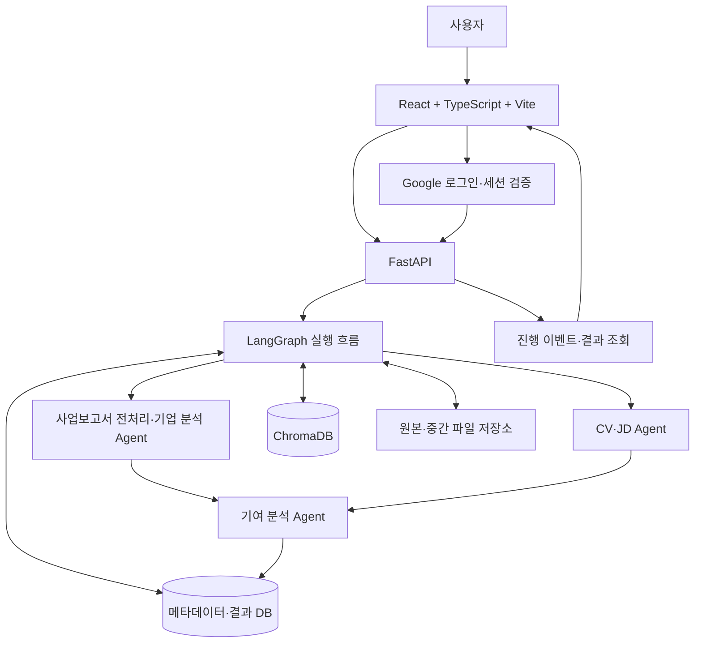

# DART Insight 2차 개발 기준과 실행 계획

작성일: 2026-10-27

상태: 사용자와 확정한 기능을 바탕으로 한 개발 기준 초안. 미정 항목은 별도 표시한다.

작업 브랜치: `production-transition`

## 1. 개발의 중심축

**사용자의 CV를 바탕으로 여러 기업·지원 직무를 분석하고, 내 경험을 어디에 어떻게 활용할 수 있는지 근거와 함께 비교하는 서비스**를 만든다.

기업 요약을 읽는 데서 끝내지 않고, 사용자가 기업·직무별 지원동기와 면접에서 강조할 경험을 선택하도록 돕는다. 기여 분석은 실제 입사 후 성과나 합격 가능성의 예측이 아니라, 제출 자료에서 확인되는 연결 가능성과 한계의 설명이다.

개발 판단의 우선순위는 다음과 같다.

1. 기업·지원자·직무의 사실을 구분하고 원문 근거를 추적할 수 있어야 한다.
2. 기업·직무별 결과를 공통 항목으로 비교하고, 사용한 CV가 다르면 입력 조건의 차이를 표시해야 한다.
3. 자료가 부족하면 추측으로 채우지 않고 판단할 수 없는 항목을 표시한다.
4. 사용자별 자료와 결과를 분리하고, 저장·재조회·삭제가 가능해야 한다.
5. 위 사용자 흐름이 LangGraph·FastAPI·ChromaDB·Docker 구조에서 실제로 동작해야 한다.

## 2. 확정한 범위

| 항목 | 결정 |
|---|---|
| 입력 방식 | 사업보고서·CV·JD PDF를 사용자가 직접 업로드 |
| 자동 수집 | 기업 검색 기반 사업보고서 수집, OpenDART 연동, JD 자동 검색은 제외 |
| 핵심 비교 | 기업·지원 직무별 기여 가능성 비교. 같은 CV 사용을 권장하되 다른 버전도 허용 |
| 비교 단위 | `기업 + 지원 직무`. 같은 기업의 다른 직무도 서로 다른 비교 대상 |
| 비교 개수 | 한 번에 최대 3개 |
| JD 미등록 | 기업 사업과 경험의 연결만 분석. 직무 요건 판단은 불가로 표시 |
| 판단 표현 | 직접 연결 / 간접 연결 / 자료 부족과 이유·근거 제공 |
| 종합 평가 | 첫 버전에서 종합점수·기업 순위 제공하지 않음 |
| 로그인 | Google 로그인 한 가지로 시작 |
| 공개 화면 | 서비스 소개 화면 |
| 로그인 필요 | 업로드·분석·자료 및 이력 조회·비교·다운로드·삭제 |
| 자료 공개 범위 | 모든 원본·분석 결과·이력은 본인 계정에서만 접근 |
| 저장 | 원본 PDF와 분석 결과를 저장하고 다시 사용 |
| 삭제 | 사용자가 자료와 분석 이력을 직접 삭제 가능 |
| CV 삭제 | 해당 CV로 생성한 개인화 결과도 함께 삭제. 독립된 기업 브리프는 유지 |
| 삭제 안내 | 삭제 전에 함께 없어질 자료·결과를 표시 |
| 화면 개발 | React + TypeScript + Vite로 독립 웹 프론트엔드 신규 개발. FastAPI와 연결 |

계정 간 기업 분석 공유, 관심 기업을 통한 성향 분류, 원문 챗봇, 추가 로그인 제공자는 이번 핵심 범위에 넣지 않는다. 향후 확장 시 별도 결정한다.

## 3. 현재 출발점과 작업 위치

### 실제 확인한 상태

- 현재 2차 작업 폴더는 `C:\Users\tcodm\Documents\ChatGPT\LLMOps\dart-insight-prod`다.
- 기존 저장소의 `main` 커밋 `780994f`에서 생성한 Git worktree이며 브랜치는 `production-transition`이다.
- 현재 폴더에는 1차 기업 브리프 코드가 있다. LangGraph·FastAPI·ChromaDB·Docker 전환 및 로그인은 아직 구현되지 않았다.
- 기존 `service.py`는 Agent 1·2·3을 병렬 실행하고, Python이 결과를 검증·병합한 뒤 Agent 4를 호출한다.
- 기존 화면은 Python 서비스를 직접 호출하고, 실행 산출물과 최신 결과를 파일로 저장한다. 계정별 소유권 구조는 없다.
- 2026-10-27 원격 `main`의 `5664120`에 CV·JD·기여 분석이 통합된 것을 확인했고, 이를 `production-transition`에 병합했다.
- 이전 브랜치 분기는 상협님의 main 반영과 개인화 기능 병합으로 통합되었다. 이후 작업 전에도 최신 원격 상태와 스키마 변경을 확인한다.

### 경로 운영 원칙

- 1차 환경: `C:\Users\tcodm\Documents\ChatGPT\LLMOps\dart-insight-brief-mvp`
- 2차 개발: `C:\Users\tcodm\Documents\ChatGPT\LLMOps\dart-insight-prod`
- 완성 후 사용자가 지정한 프로젝트 모음 경로 `C:\Users\tcodm\Project\LLMOps` 아래로 이전한다.
- 이전 대상에는 별도 공공기관 채용 Agent 프로젝트가 있으므로 덮어쓰지 않는다. 하위 폴더와 Git 연결은 이전 시 확인한다.
- worktree는 단순 파일 복사로 Git 연결이 보존된다고 가정하지 않는다. 이전 단계에서 Git 경로와 실행 환경을 함께 검증한다.

## 4. 사용자 흐름

1. 소개 화면에서 서비스 목적과 예시를 확인한다.
2. Google 계정으로 로그인한다.
3. 기업별 사업보고서를 등록하고, 추출된 기업명·보고기간을 확인한다.
4. 기업 분석을 실행하거나 이미 저장된 기업 브리프를 연다.
5. 사용할 CV를 등록·선택한다.
6. 기업별 지원 직무와 JD를 연결한다. JD 없이 진행할 수도 있다.
7. 기여 분석을 실행하고 경험 연결·기여 시나리오·부족한 점·근거를 확인한다.
8. 기업·지원 직무별 분석 결과 2~3개를 선택해 공통 항목으로 나란히 비교한다. 각 결과에 사용한 CV 버전을 함께 확인한다.
9. 결과를 다시 조회하거나 다운로드한다. 원하지 않는 자료·이력은 삭제한다.

기업 브리프는 CV 없이도 생성·조회할 수 있다. 개인화 비교에는 동일한 CV 버전을 권장하지만 강제하지 않는다. 다른 CV로 만든 결과도 비교할 수 있으며, 사용한 CV 버전과 “입력 경험이 달라 동일 조건 비교가 아님”을 표시한다. 재분석은 사용자가 선택할 수 있는 보완 방법이다.

비교는 기업 브리프의 사업·전략·실적·조직 정보를 나란히 읽는 것과, 기업 fact·CV·선택적 JD를 연결한 개인화 결과를 비교하는 것으로 구분한다. 개인화 결과는 연결되는 경험, 연결 수준과 이유, 기여 시나리오, 부족한 점, 근거를 같은 행으로 보여준다. 기업의 우열이나 합격 가능성을 평가하는 순위는 만들지 않는다.

## 5. 핵심 기능과 완료 조건

| ID | 기능 | 주요 동작 | 완료 조건 |
|---|---|---|---|
| F01 | 로그인·접근 제어 | Google 로그인, 세션 확인, 계정별 자료 접근 | 비로그인 요청과 다른 계정의 자료 조회·다운로드·삭제를 백엔드에서 차단 |
| F02 | 자료 등록 | 사업보고서·CV·JD 업로드, 자료 종류·버전·소유자 기록 | 업로드 파일과 저장 기록이 연결되고 부적절한 파일은 명확한 오류 반환 |
| F03 | 기업 분석 | 자동 분할 → Agent 1·2·3 → 검증·병합 → Agent 4 | 기존 병렬 처리·근거 ID·원본 페이지·로그 정리 유지, 실패 시 불완전한 브리프를 완료로 표시하지 않음 |
| F04 | CV·JD 분석 | CV 경험·역량, JD 업무·요건 추출 | 추출 결과를 원본과 연결해 저장하고 자료 미기재 항목을 생성하지 않음 |
| F05 | 기여 분석 | 기업 fact + CV + 선택적 JD 연결 | 연결 수준·이유·기여 시나리오·부족한 점과 추적 가능한 근거 제공 |
| F06 | 기업·직무 비교 | 기업·직무별 분석 결과 최대 3개 비교 | 공통 항목·사용 CV 버전 표시, 서로 다른 CV 입력 조건 및 JD 미등록·자료 부족을 구분 |
| F07 | 근거 확인 | 기업·CV·JD 인용문, 파일명·위치 표시 | 근거 ID에서 실제 사용 문서를 식별 가능. PDF 페이지 이동은 대표 문서로 검증 후 제공 |
| F08 | 진행 상태·실패 복구 | 단계별 상태, SSE 진행 표시, 실패 이유·재시도 | 화면 재렌더링·재접속만으로 Agent를 중복 호출하지 않고 저장 상태 재조회 가능 |
| F09 | 저장·재사용 | 기업 브리프·자료·개인화 이력 다시 열기 | 로그아웃·재로그인과 컨테이너 재시작 후에도 본인 결과 조회 가능 |
| F10 | 삭제 | 대상과 연관 결과 미리보기, 삭제 실행 | CV의 파생 개인화 결과 및 비교 저장물이 함께 정리되고 독립 기업 브리프는 유지 |
| F11 | 다운로드 | 기업 브리프·기여 보고서·비교 결과 내려받기 | 화면과 동일한 자료 버전·내용·근거·한계를 포함 |
| F12 | Docker 실행·문서화 | 프론트엔드·백엔드·ChromaDB 실행, 설정·실행법 제공 | README를 따라 별도 환경에서 실행하고 대표 사용자 흐름 완료 |

다운로드 기본 형식은 Markdown·JSON으로 제안한다. 완성 보고서 PDF 출력은 추가 범위이며 필수로 확정하지 않았다.

## 6. 기여 분석과 비교 기준

비교 화면은 다음 공통 항목을 사용한다. 세부 Agent 출력 필드와 판정 규칙은 상협님과 협의 후 고정한다.

| 항목 | 설명 |
|---|---|
| 기업 사업·프로젝트 | 지원자의 경험과 연결할 수 있는 회사 고유 사실 |
| 지원 직무·요건 | JD에서 확인한 업무·필수·우대 요건. JD가 없으면 판단 불가 |
| 연결되는 내 경험 | CV의 실제 경험·역할·사용 기술·성과 |
| 연결 수준과 이유 | 직접 연결 / 간접 연결 / 자료 부족. 판단 이유를 함께 제시 |
| 가능한 기여 | 어떤 업무에 어떤 경험을 어떻게 활용할 수 있는지 제안 |
| 부족한 점 | 추가 역량·입증 자료·확인이 필요한 사항 |
| 근거 | 기업 fact ID, CV 근거, JD 근거와 원문 위치 |

표현 원칙:

- 회사가 밝힌 사실, 사용자의 실제 경험, AI의 기여 제안을 구분한다.
- JD가 없으면 직무 요건을 추정해 넣지 않는다.
- 비전·인재상은 자료에서 확인되는 경우에만 보조 근거로 사용한다.
- 연결 수준은 기업 전체에 단일 등급을 붙이기보다 항목별로 제시한다.
- 기업별 보고기간과 JD 시점을 표시한다. 사업보고서의 계획이 현재도 진행 중이라고 단정하지 않는다.
- 학위·경력의 대안 조건을 모두 충족해야 하는 조건으로 바꾸지 않는다.
- 종합점수·기업 순위·입사 후 성과·합격 가능성을 만들어내지 않는다.

현재 팀원 기여 분석은 Markdown 보고서 텍스트를 반환하는 구조다. 안정적인 비교 UI에는 구조화된 결과가 필요하므로, 구조화 JSON을 반환하고 Markdown은 렌더링하는 방향을 제안한다. 이는 아직 반영된 기능이 아니며 Agent 담당자와 합의할 연결 변경이다.

## 7. 목표 아키텍처

### 책임 분리

| 구성 | 책임 | 하지 않는 일 |
|---|---|---|
| React + TypeScript + Vite | 독립 웹 UI 개발·빌드, 입력·선택·진행 표시·결과·비교·삭제 확인 | Studio 직접 호출, 신뢰할 수 없는 사용자 ID 전달만으로 권한 결정 |
| FastAPI | 인증·소유권 검사, 업로드, 실행 요청, 상태·결과·삭제 API | 화면 세션만 믿고 파일·결과 공개 |
| LangGraph | 기업 분석·지원자 분석·기여 분석의 순서·분기·검증·재시도 | 사용자 권한 검사 대신하기, 무제한 재시도 |
| Studio 호출 계층 | 업로드·작업 생성·폴링·타임아웃·결과 파싱 | 프론트엔드 요소 직접 조작 |
| 결과 DB | 사용자·자료·버전·실행 상태·결과·의존 관계 | 의미 검색 전용 저장소로 사용 |
| ChromaDB | 계정·기업·보고서 범위 안에서 관련 fact 검색 | 전체 실행 이력·소유권의 유일한 원장으로 사용 |
| 파일 저장소 | 원본 PDF·파생 입력 파일 보관 | 서버 절대 경로를 클라이언트에 공개 |

Google 로그인이 UI에 표시되는 것만으로 인증이 완성되지는 않는다. 백엔드가 신뢰할 수 있게 사용자 신원을 검증하고, 모든 자료 접근에서 소유권을 검사해야 한다. 구체적인 인증 라이브러리·세션 전달 방식은 미정이다.

Docker Compose 기본 구성은 frontend·backend·chromadb 세 서비스로 제안한다. 메타데이터 DB는 초기에는 SQLite와 영속 볼륨을 사용하고, 다중 서버 운영이 필요하면 별도 DB로 전환할 수 있게 저장 계층을 분리한다. SQLite 선택은 기술 제안이며 확정 결정은 아니다.

장시간 분석은 백엔드가 실행 ID와 상태를 관리하고, 화면은 해당 실행의 이벤트와 결과를 구독·조회하는 구조로 제안한다. 초기 구현은 단일 백엔드 프로세스로 범위를 제한하며, 별도 작업 큐·워커 도입은 운영 규모에 따라 결정한다.

## 8. LangGraph와 ChromaDB 적용 방식

### LangGraph

- 기업 분석: 전처리 → 세 추출 작업 병렬 실행 → 모두 완료 확인 → 근거 검증·병합 → 브리프 생성.
- 지원자 분석: 선택한 CV·JD 버전의 기존 성공 결과를 확인하고 필요한 추출만 실행.
- 기여 분석: 자료 소유권·버전 확인 → 관련 fact 검색 → 입력 구성 → 기여 분석 → 구조·근거 검증 → 저장.
- JD 미등록 분기는 입력 구성과 출력 검증에서 모두 적용한다. 빈 JD를 넣고 Agent가 임의 추정하도록 두지 않는다.
- Studio Agent 내부 설정과 LangGraph 실행 흐름은 별도 책임이다.
- 실패·타임아웃·재시도 횟수를 기록하고, 성공 결과는 같은 실행의 유효한 자료에 한해 재사용한다.

### ChromaDB

- 기업 fact의 문장과 근거 정보를 검색 가능한 단위로 적재한다.
- CV·직무 요건과 관련된 기업 fact를 검색해 근거 후보로 사용한다.
- 검색 metadata에 사용자 ID·기업 분석 ID·보고서 버전·fact ID를 유지한다.
- 사용자·기업·문서 범위 필터는 서버에서 강제한다. 클라이언트가 임의 해제할 수 없게 한다.
- 벡터 유사도를 기여 점수나 적합도 점수로 표시하지 않는다.
- 검색에 잡히지 않은 사실을 회사에 존재하지 않는 사실로 취급하지 않는다.
- 전체 fact 입력 대비 검색이 중요한 근거를 누락하지 않는지 대표 사례로 평가한 뒤 입력 축소 범위를 정한다.
- 임베딩 모델과 청크·검색 설정은 평가 후 확정하고 버전을 기록한다.

## 9. 저장·버전·삭제 설계 원칙

저장할 주요 개념은 다음과 같다. 최종 DB 스키마는 구현 단계에서 구체화한다.

| 개념 | 필요한 연결 |
|---|---|
| 사용자 | 검증된 로그인 제공자·고유 사용자 식별자 |
| 자료 | 소유자, 종류, 파일 식별자·해시, 버전, 등록·삭제 상태 |
| 기업 분석 | 사업보고서 버전, 추출 결과·병합 fact·브리프, Agent 설정 버전 |
| CV·JD 추출 | 해당 자료 버전, 추출 결과와 근거 |
| 기여 분석 | 기업 분석 ID, CV 버전, 선택적 JD 버전, 지원 직무, 결과·근거 |
| 비교 | 최대 3개 기여 결과와 각 결과의 CV 버전 연결. CV가 달라도 허용하며 차이를 표시. 저장 여부는 미정 |
| 실행 | 소유자, 단계·상태·오류, 입력 버전, 진행 이벤트와 결과 참조 |

구현상 주의할 점:

- 로그인 계정별 캐시를 분리한다. 동일 파일이라도 다른 사용자의 분석 결과를 그대로 노출하지 않는다.
- 입력 해시뿐 아니라 Agent 설정·스키마·전처리 버전을 포함해 재사용 여부를 판단한다.
- 기존 `latest_company_brief` 전역 파일을 사용자 결과 조회의 기준으로 사용하지 않는다.
- CV 삭제 시 원본·추출 결과·중간 입력 PDF·파생 개인화 결과·연관 비교 데이터 및 검색 색인을 추적해 정리한다.
- 진행 중 분석의 입력이 삭제되면 후속 결과 공개·저장을 차단해 삭제된 자료가 다시 나타나지 않게 한다.
- DB·파일·ChromaDB 삭제 일부가 실패하면 삭제 대기·실패 상태와 재시도 경로를 둔다. 완료 전에 완전 삭제로 표시하지 않는다.
- Studio에 업로드한 원격 파일의 삭제 가능 범위·정책도 확인한다. 원격 삭제 미확인 상태에서 모든 사본의 즉시 삭제를 보장하지 않는다.
- 사업보고서·JD 삭제 시 파생 결과 처리와 보관 기간은 추가 결정이 필요하다.

## 10. 화면 구성

| 화면 | 주요 기능 |
|---|---|
| 소개·로그인 | 서비스 목적, 예시, 자료 사용 안내, Google 로그인 |
| 내 분석 목록 | 기업·보고기간·지원 직무·상태별 결과 목록, 새 분석, 기존 결과 열기 |
| 기업 상세 | 기업 브리프, 상세 fact, 원문 근거, 다운로드 |
| 내 자료 | CV·JD 등록·버전 선택·기업/직무 연결·삭제 영향 확인 |
| 기여 분석 | CV·기업/직무 선택, JD 선택적 등록, 분석 상태, 연결 수준·기여·부족한 점 |
| 기업·직무 비교 | 최대 3개 대상, 공통 비교 항목, CV 버전·입력 차이, 근거·한계, 다운로드 |

모든 주요 화면은 빈 상태·진행 중·일부 실패·완료·자료 부족·권한 만료 상태를 설계한다. JD가 없는 분석과 있는 분석을 함께 볼 때는 평가 범위 차이를 명시한다.

UI 레퍼런스는 사용자가 추후 제공한다. 2차 화면은 Streamlit을 사용하지 않고 독립 웹 프론트엔드로 새로 개발하며, FastAPI와 연결한다. 레퍼런스에 맞춰 정보 구조·동선·컴포넌트를 설계한다. 프론트엔드 기술은 React + TypeScript + Vite로 확정했다. React는 화면 구성과 상호작용, TypeScript는 프론트엔드 자료형·API 계약 표현, Vite는 개발 서버와 빌드를 담당한다. 구체적인 색상·배치·카드 스타일도 미정이다.

## 11. 역할 분담과 협업 규칙

| 담당 | 범위 |
|---|---|
| 채은 | 2차 폴더·실행 구조, API·인증·저장·검색·LangGraph, 독립 웹 UI, Docker·README |
| 상협 | Studio Agent 프롬프트·노드·출력 품질, CV·JD·기여 분석 고도화 |
| 공동 | 기여 기준·출력 규격, 대표 사례 선정, 결과 검증, 범위 변경 |

- 기업 Agent 1·2·3과 기존 fact 스키마는 이미 있는 코드를 기준으로 사용한다.
- 상협님이 구현한 개인화 입력 구성·호출 코드를 확인하고 이식한다. 이미 있는 사실을 다시 설계하기 위한 질문으로 반복하지 않는다.
- 비교용 구조화 출력과 JD 선택 입력 지원은 현재 코드에서 충족되는지 확인하고, 필요한 변경만 요청한다.
- Studio 내부 수정과 Python 파일 이동을 구분한다. 코드 이동 기간에는 동일 파일의 병행 수정을 사전 공유한다.
- Agent 출력 필드·타입·근거 참조·Config ID가 바뀌면 샘플 결과와 변경 내역을 함께 공유한다.
- API 키·실제 CV·원본 업로드·분석 결과를 Git에 커밋하지 않는다. 익명화된 샘플로 연결을 검증한다.

## 12. 개발 단계와 완료 기준

단계는 일정 추정 대신 선행 조건과 검증 가능한 결과를 기준으로 진행한다. 아래는 실행 계획이며 아직 완료된 것으로 표시하지 않는다.

### 단계 0. 공통 기준 코드와 연결 규격 확정

- [ ] 최신 원격 `main`·`sanghyeob`를 확인하고 2차 브랜치에 통합한다.
- [ ] 병렬 처리·로그 정리·요약 개선과 CV·JD·기여 분석을 함께 유지한다.
- [ ] Agent별 입력·출력·설정 변수·익명 샘플을 정리한다.
- [ ] 비교용 구조화 결과와 JD 선택 입력 지원을 협의한다.
- [ ] 기존 테스트와 대표 샘플로 통합 기준 상태를 확인한다.

완료 조건: 통합 코드와 계약 문서·샘플이 있고, 현재 동작과 향후 변경점을 구분할 수 있다.

### 단계 1. 인증·저장·API를 통한 기업 분석 한 흐름 완성

- [ ] Google 로그인과 백엔드 사용자 검증을 연결한다.
- [ ] 계정별 파일·분석 기록 저장 구조를 만든다.
- [ ] 기존 기업 분석 로직을 UI와 분리하고 FastAPI로 호출한다.
- [ ] 독립 웹 프론트엔드에서 로그인 → 업로드 → 분석 → 결과 저장·재조회까지 연결한다.
- [ ] 다른 사용자의 자료 접근과 비로그인 API 요청을 차단한다.

완료 조건: 로그인한 사용자가 기업 한 곳을 분석하고 재로그인 후 자기 결과를 다시 볼 수 있다.

### 단계 2. LangGraph·진행 이벤트·실패 처리

- [ ] 기업 분석을 그래프 노드로 옮기고 추출 작업의 병렬성과 고정 병합 순서를 유지한다.
- [ ] 실행 ID·단계·실패 상태를 저장한다.
- [ ] SSE 진행 이벤트와 상태 조회 API를 UI에 연결한다.
- [ ] 타임아웃·부분 실패·재접속·중복 실행 방지를 검증한다.

완료 조건: 정상·실패 실행의 상태가 일관되게 표시되고, 새로고침이 새 분석을 만들지 않는다.

### 단계 3. CV·JD·기여 분석과 ChromaDB 연결

- [ ] CV·JD 추출 결과와 버전을 저장하고 기업·지원 직무에 연결한다.
- [ ] fact를 색인하고 계정·기업·보고서 범위 안에서 검색한다.
- [ ] 기업 fact·CV·선택적 JD를 사용한 기여 분석 그래프를 연결한다.
- [ ] 구조화된 결과에서 기여 보고서와 근거 화면을 렌더링한다.
- [ ] JD 미등록·빈 근거·자료 불일치 사례를 검증한다.

완료 조건: JD 유무에 따라 분석 범위를 정확히 구분하며 근거가 연결된 개인화 결과를 만든다.

### 단계 4. 여러 기업 비교·자료 관리·UI 레퍼런스 적용

- [ ] 기업·직무 2~3개를 공통 항목으로 비교하고, 다른 CV 버전도 입력 차이를 표시해 허용한다.
- [ ] 원본 근거 확인과 결과 다운로드를 제공한다.
- [ ] 자료·분석 삭제 미리보기와 CV 파생 결과 삭제를 구현한다.
- [ ] 사용자 UI 레퍼런스를 반영하고 모든 주요 화면 상태를 점검한다.
- [ ] 상협님과 대표 결과의 연결 판단·근거·과장 여부를 검토한다.

완료 조건: 사용자가 기업별 강조 경험과 준비할 점을 비교하고, 삭제 후 관련 개인화 결과가 남지 않는다.

### 단계 5. Docker·평가·README·이전 준비

- [ ] Docker Compose로 프론트엔드·백엔드·ChromaDB를 함께 실행한다.
- [ ] 로그인 리디렉션·환경변수·한글 폰트·영속 볼륨을 확인한다.
- [ ] 컨테이너 재시작 후 자료 보존과 계정별 접근을 검증한다.
- [ ] 기능·아키텍처·환경변수·실행법·평가 결과·알려진 한계를 README에 작성한다.
- [ ] 과제의 이미지 패키징·평가 제출 세부 조건은 강의 자료와 대조한다.
- [ ] 완료 후 프로젝트 모음 경로로 이전하고 Git·실행 환경을 검증한다.

완료 조건: README를 따라 실행 가능한 산출물과, 대표 사례의 검증 결과·한계가 준비된다.

## 13. 평가와 발표에서 증명할 것

대표 시나리오는 같은 CV 1개와 기업 2곳의 사업보고서·JD를 사용한다. 추가로 서로 다른 CV 버전, JD가 없는 대상, 동일 기업의 다른 직무를 검증한다.

| 검증 영역 | 확인할 행동 |
|---|---|
| 차별점 | 일반 기업 요약에 더해 내 경험·지원 직무·근거를 연결하고 여러 대상을 비교할 수 있음 |
| 근거 품질 | 핵심 사실·경험·직무 요건이 해당 원문의 실제 내용을 뒷받침함 |
| 판단 일관성 | 기업마다 같은 비교 항목을 적용하고 자료 부족과 부적합을 구분함 |
| 범위 제한 | JD가 없을 때 요건·필수 역량을 만들어내지 않음 |
| 사용자 격리 | 두 계정의 목록·파일·결과·SSE·검색·삭제가 섞이지 않음 |
| 실행 안정성 | 재접속·Agent 일부 실패·타임아웃에도 상태가 설명 가능하고 중복 호출을 방지함 |
| 삭제 | CV 파생 결과와 입력 파일·색인이 정리되며 실행 중 삭제가 자료를 되살리지 않음 |
| 운영 재현성 | Docker 재시작 후 저장 결과가 유지되고 문서에 따라 실행 가능함 |

추출 Agent 3개로 나눈 이유는 문서 크기에 따른 처리 부담과 영역별 추출 목적을 함께 설명한다. 각 JSON이 기업 브리프·개인화·검색·비교에서 어떻게 쓰이는지도 실제 사례로 보여준다.

## 14. 남은 결정과 확인 사항

다음은 이미 확정한 기능을 되묻는 항목이 아니라 구현 전에 구체화할 기술·운영 사항이다.

- Google 로그인 라이브러리·백엔드 세션 전달 방식과 실제 배포 주소.
- 기여 분석의 구조화 출력 필드·판정 규칙·CV/JD 근거 식별 방식.
- JD 미등록을 현재 기여 Agent가 지원하는지 여부와 필요한 수정.
- 자료 보관 기간, 사업보고서·JD 삭제 시 파생 결과 처리, 원격 Studio 파일 정리 정책.
- SQLite 채택 여부, 실행 중 서버 재시작 시 복구 범위, 동시 분석 제한.
- 임베딩 모델·검색 설정과 전체 fact 대비 검색 품질 검증.
- 비교 결과 자체를 별도 저장할지, 저장된 개인화 결과에서 매번 조합할지.
- 업로드 용량·분석 대기 시간·재시도 횟수와 사용자 안내 문구.
- 프론트엔드 스타일링·컴포넌트 도구, 사용자가 전달할 UI 레퍼런스와 최종 화면 구성. React + TypeScript + Vite는 확정.

결정할 때마다 이 문서를 수정한다. 새 기능을 추가하기 전에 핵심 사용자 흐름과 과제 필수 요건에 필요한지 확인하고, 범위와 완료 기준을 함께 갱신한다.

## 15. 근거 자료

- 사용자와 이 채팅에서 확정한 요구사항 및 역할 분담.
- [2차 프로젝트 가이드](https://jnu-project-guide.vercel.app/2): LangGraph·FastAPI·ChromaDB·Docker 전환과 문서화 요구사항.
- [중간발표 자료](https://docs.google.com/presentation/d/1s8Ln-_LJSCbagl3gWkK_IebfcsYa2F22/edit): 기업 fact 기반 브리프와 개인화 고도화 방향.
- 멘토 피드백: `C:\Users\tcodm\Downloads\3조_중간피드백.pdf` — 여러 기업 비교, 기여 판단 기준, 원문 위치, 차별점·대표 사례 검증.
- 현재 작업 폴더의 `README.md`, `service.py`, `streamlit_app.py`와 앞서 확인한 팀원 브랜치 개인화 코드.

이 문서는 완료 보고서가 아니다. 현재 구현과 확정 요구사항, 제안 설계, 남은 결정을 구분하여 이후 개발의 기준으로 사용한다.
